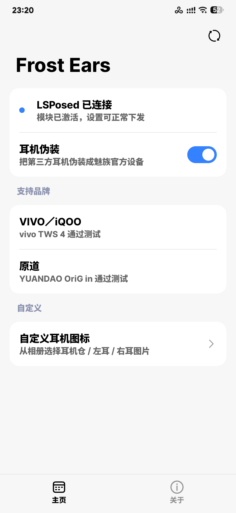

# Frost Ears

> 让第三方 TWS 耳机出现在魅族控制中心，本意只是为了快捷噪声控制

基于 [libxposed](https://github.com/libxposed/api) API 102 的 LSPosed 模块。
把 vivo / iQOO、原道 NiceHCK、HUAWEI FreeBuds 等品牌的真无线耳机伪装成魅族官方设备，
让控制中心卡片、魅族耳机 App 能正常显示设备名、电量与降噪状态。

  

## 功能

- **耳机卡片接管** —— 控制中心出现耳机卡片，显示真实设备名 + 左耳 / 右耳 / 仓电量
- **降噪控制** —— 卡片内切换「关闭 / 降噪 / 通透」，直接下发到耳机
- **更多设置跳转** —— 跳对应品牌官方 App，未安装则回落到系统蓝牙设备详情页
- **自定义图标** —— 从相册选耳机仓 / 左耳 / 右耳图片，替换卡片与弹窗图标
- **一键重启作用域** —— root 下 `pkill` 系统界面或蓝牙相关进程，不用手动重启
- **Miuix 界面** —— HyperOS 风格，模糊标题栏、动态渐变背景、Foreground Blur 文字

## 支持设备

| 品牌 | 协议 | 状态 |
|---|---|---|
| vivo / iQOO | GAIA（RFCOMM） | vivo TWS 4 通过测试 |
| 原道 NiceHCK / YUANDAO OriG in | NiceHCK 二进制 RFCOMM | YUANDAO OriG in 通过测试 |
| HUAWEI FreeBuds / FreeClip / FreeLace | Huawei 5A SPP | FreeBuds 7i 通过测试 |

> 新品牌只需在 `EarbudCatalog` 登记，并在 `BluetoothHook` 增加对应协议实现。

## 使用要求

- Android 13 及以上（minSdk 33，模糊效果依赖 RuntimeShader）
- 已 root，并安装 LSPosed
- 作用域：`系统界面`、`蓝牙`、`魅族耳机`（用到 IoT 入口再加 `魅族 IoT`）

## 使用方法

1. 在 LSPosed 中启用模块，勾选上面的作用域
2. 打开 Frost Ears，开启「耳机伪装」总开关
3. 连接耳机，下拉控制中心即可看到卡片
4. 想换图标：首页 →「自定义耳机图标」→ 从相册选择仓 / 左 / 右

## 致谢

- [HyperEars](https://github.com/silverpoetry/HyperEars)（GPL-3.0）—— 本项目基于其源码改造
- [Miuix](https://github.com/compose-miuix-ui/miuix) —— HyperOS 风格 Compose 组件库
- [LSPosed](https://github.com/LSPosed/LSPosed) · [libxposed](https://github.com/libxposed/api)

## 免责声明

仅供学习交流，使用产生的风险由使用者自行承担，请勿用于商业用途。

## License

[GPL-3.0](LICENSE)

